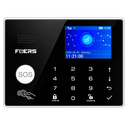
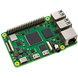

# 🎨 Zabbix Icons Collection

 | 

A custom collection of icons for the **Zabbix** monitoring system.

I use these icons to visualize devices and services in my IT infrastructure.

## 🖼️ Icon Gallery

| 🚨 ALARM | 🕹️ ARCADE 101 |
|:---:|:---:|
|  |  |
| Alarm system | Arcade machine |

| 🍓 Raspberry Pi | 📺 TV |
|:---:|:---:|
|  |  |
| Raspberry Pi | Smart TV |

## 📁 Repository Structure

- `ALARM/` – alarm system icons
- `arcade_101/` – arcade machine icons
- `raspberry/` – Raspberry Pi icons
- `tv/` – television icons

## 📐 Available Resolutions

Each icon is available in three sizes:

- 64 × 64 px
- 96 × 96 px
- 128 × 128 px

## 🛠️ Usage

The images are ready to use in Zabbix, for example when creating network maps and visualizing monitored devices.

---

**iBasterisk | Zabbix Monitoring**

A private icon collection for my personal homelab.
